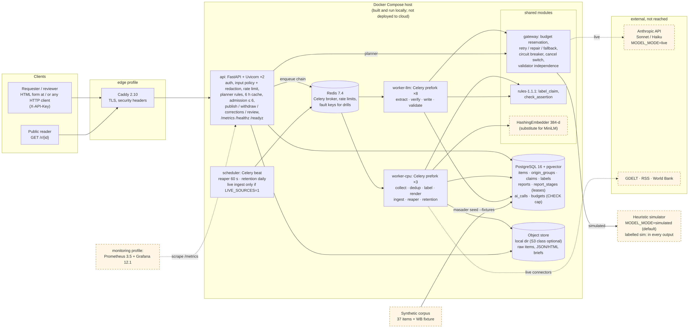

# Architecture as implemented



The same diagram, rendered live from its Mermaid source (`docs/architecture.mmd`):

```mermaid
--8<-- "docs/architecture.mmd"
```

The design this implements is the Technical Architecture v1.2 (28 Oct 2026); every difference is listed with
its reason in [Deviations from the architecture](deviations.md).

Downloads: [implementation report (PDF)](Masader_Implementation_Report.pdf) ·
[report (Word)](Masader_Implementation_Report.docx) · [OpenAPI document](openapi.v1.json)
